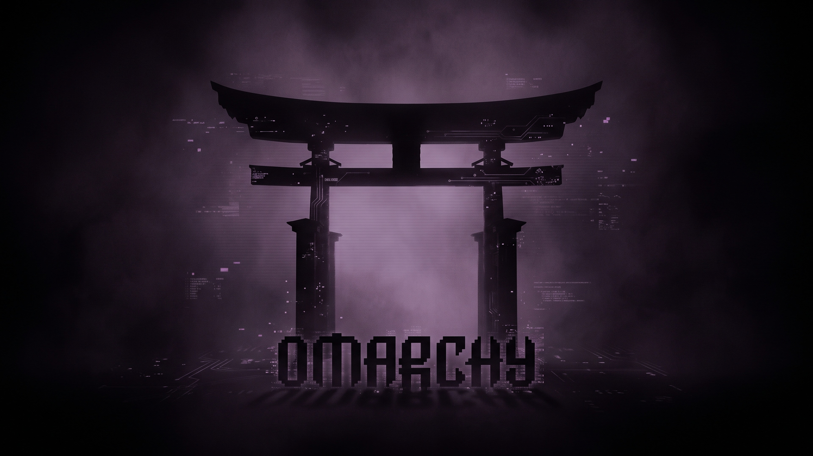

# Catppuccin House Special

A dark, dimmed Catppuccin Mocha theme for [Omarchy](https://omarchy.org), tuned for long terminal sessions at night.



## What makes it special

- **Near-black background** (`#010101`) instead of Mocha's blue-gray base.
- **Dimmed text.** The foreground is Catppuccin's Subtext 1 (`#bac2de`), and the terminal colors are scaled to 86% brightness, so on black the contrast is about what stock Mocha has on its own background (around 12:1 instead of 15:1).
- **Mauve accent** (`#cba6f7`) for focused window borders, menus, the launcher and btop highlights, matching the purple icon set.
- **Calm selection.** Selected text uses Surface 1 (`#45475a`) instead of a bright block.
- **btop** with dimmed graph colors and a visible selected-process row.
- **Six wallpapers** around the Omarchy logo: a misty mauve doorway, an Arch Linux portal, tiled windows, an omakase torii gate, a digital logo, and the classic pixel logo.

## Install

```bash
omarchy theme install https://github.com/stewartjarod/omarchy-catppuccin-house-special-theme
```

## Credits

- Colors from the [Catppuccin](https://catppuccin.com/palette/) Mocha palette (MIT).
- Started as a variant of [Luquatic/omarchy-catppuccin-dark](https://github.com/Luquatic/omarchy-catppuccin-dark); `btop.theme` derives from Catppuccin's [btop theme](https://github.com/catppuccin/btop) (MIT).
- The portal wallpapers were generated with Gemini, using the second wallpaper of [Golden Brown](https://github.com/atif-1402/omarchy-golden-brown-theme) (MIT, Copyright (c) 2026 anom538) as the reference.
- The Omarchy logo belongs to the [Omarchy](https://github.com/omacom/omarchy) project.

## License

[MIT](LICENSE)
